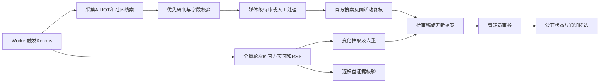
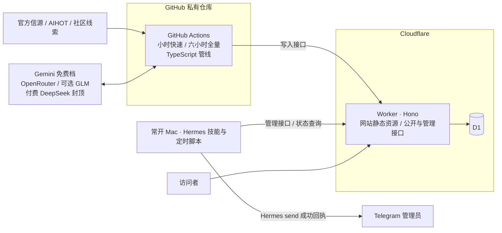

# AI 羊毛牧场 · 设计文档

> 现役架构校对：2026-10-12。业务收录/字段以 [数据合同](data-contract.md) 和 [抽取规则](../pipeline/learned-rules.md) 为准；部署与未完成事项见 [运维说明](operations.md)。历史决策只作回溯。

## 1. 定位

一个**审核后可追溯的 AI 羊毛库**：汇总全球可以免费薅的 AI 额度和权益，配每日变化简报。

- 只收"能薅的"。模型发布、功能更新、一般行业新闻、普通打折不收；身份专享与近免费体验例外见数据合同。
- 先给 10 人以内小范围使用，之后公开给更多人。
- 尽量零成本；唯一固定开销是域名（约 ¥75/年）。

## 2. 收录范围

| 收 | 说明 |
|---|---|
| API token / 免费额度 | 模型厂商、云厂商、推理平台的赠送额度和免费层 |
| AI 编程工具额度 | Gemini CLI、Qwen Code 每日免费次数，Cursor / Kiro 试用，Codex / Claude Code 额度重置 |
| C 端会员赠送 | 会员限时免费、学生免费一年等 |
| 申请制 credits | AWS Activate、Google for Startups、各厂商创业计划等，单独成类，只收官方长期计划 |
| 多模态生成积分 | 图像、视频、音乐、语音生成的免费积分和限免 |

**不收**：通用云/GPU/沙箱额度、工具目录、免费套餐名称本身、付费档内含权益、常设阶梯价、消费返利、首购/升级付费赠额与普通折扣。身份认证免费会员/五折以下优惠、首月实付≤$1 等例外以数据合同现行口径为准。

## 3. 平台准入

**收**：
1. 模型厂商（OpenAI、Anthropic、Google、DeepSeek、Kimi、智谱、MiniMax 等）
2. 云厂商（阿里云百炼、火山方舟、腾讯云、百度千帆、AWS、Azure、GCP）
3. 有公开公司主体、自营或正规接入推理的平台（OpenRouter、OpenCode Zen、Vercel AI Gateway、Cloudflare Workers AI、GitHub Models、Hugging Face、Groq、Cerebras、Together、Fireworks、硅基流动等）
4. 知名 AI 工具本身（Cursor、Kiro、Trae、可灵、即梦、Suno 等）
5. 新玩家（新实验室、新产品，如 Jev），经人工准入后收录

**不收**：基于 one-api / new-api 搭的分销中转站、号池、拼车或共享账号、按官方价打折倒卖的站、镜像站。

平台维护在一张显式白名单里。**新平台第一次出现，一律由管理员人工准入。**

平台可登记 `aliases`（产品名，如 ZCode → 智谱、海螺AI → MiniMax 的海螺 AI）和 `company`（母公司，如 Qoder、千问办公 → 阿里巴巴）。产品平台的名称以厂商开头（如“MiniMax 海螺 AI”“阿里 Qoder”），条目卡片、详情、Agent 接口和日报都显示厂商；按公司分组的公开列表在公司标题下只显示产品名。别名用于把只写产品名的线索对应到平台；母公司只用于公开列表按公司分组和整组筛选，不改变平台 ID、条目与审核历史。公开列表只列有条目的平台。模型系列名（GLM、GPT 等）不作别名，因为其他平台也提供这些模型。

## 4. 信源与证据

### 4.1 信源分级
| 级别 | 例子 | 能否作为正式证据 |
|---|---|---|
| 官网公告 / 帮助文档 | 定价页、公告页、活动页、文档 | 能 |
| 官方账号 | 厂商官方 X、官方公众号 | 能 |
| 员工账号 | 白名单内的在职员工 X 账号（如宣布 Codex 重置的员工） | 能，但永不自动上架 |
| 线索 | AIHOT、媒体报道、社区帖、人工调查；订阅邮件待接入 | 不能，必须追到官方出处 |

员工账号进白名单需有依据：被官方账号转发过，或能在官网团队页查到。

### 4.2 证据规则
- 正式上架必须能追到官方出处，并保存**支持关键条款的原文摘录**、链接和抓取时间。
- 首次批准“截止未知”活动时，应有仍可访问的权益页或领取页作证据；旧公告仍能打开，不能单独证明首次审核时仍可领取。批准后不定期重抓旧证据，明确撤回或真实条款变化另行处理。
- 模型判断不能替代官方证据。
- 资格没写清楚的标"资格未明确"，不写成人人可领。

### 4.3 渠道覆盖
| 渠道 | 方式 | 备注 |
|---|---|---|
| 官网 / 文档 / 博客 | 直接抓取（RSS、网页列表、JSON） | 主力 |
| X | AIHOT公开接口、官网同步公告、待审稿官方搜索复核 | 官方搜索只查目标活动，不等于持续抓取全部账号时间线；缺口由人工补录补足 |
| 公众号 | 已登记官方账号的文章（平台 `wechat` 存其 `__biz`）算官方证据；未登记账号、无 `__biz` 的短链只作线索，靠补录 | 免费方案；管理员通过公众号证据的条目时自动登记该账号 |
| 订阅邮件 | 设计规划，当前没有邮件接收 Worker 实现 | 未接入 |
| 补录 | 后台粘贴链接，或把链接转发给 Telegram 机器人 | 补公众号和 X 的缺口 |
| 社区与媒体 | LINUX DO、IT之家及 Reset Radar / AgentDeals / V2EX RSS；3 个目录登记但停用 | 只作线索；详见运维配置 |
| Hacker News | 官方免费搜索接口（Algolia），每 6 小时，关键词粗筛 | 只作线索 |
| Reddit | 云端直接读取暂停；常开 Mac 中继负责可访问的公开来源。官方 API 接入须待申请通过后配置凭据。 | 只作线索 |
| Discord | 自建服务器，关注厂商官方服务器的公告频道，由机器人读取；首批 4～6 家多模态厂商（Midjourney、Suno、Pika、Luma 等） | 官方来源需核实原始频道映射；2026-10-10已接入自建接收频道读取，条目独立待审；不读取他人服务器消息API |
| 发现扫描 | 人工调查/补录；仓库未提供每周社区扫描的自动任务 | 不把每周纠正规则 PR 当扫描任务 |

付费X/公众号采集接口尚未接入。早期按漏报次数决定启用的规则是设计提案，仍需单独配置和授权，不能当作现有自动行为。

AIHOT 数据的使用边界：只作线索，页面引用官方原文。其条款允许个人、公益非商业和组织内部免费使用；若以后商业化，需先向其申请书面授权。

## 5. 数据模型

详情页“牧场心得”是共同留言列表：`offer_comments` 存管理员和匿名访客的多条体验，`anonymous_comment_users` 分配唯一六位公开 ID 与持久会话，`comment_rate_limits` 原子限制写入。作者身份由服务端认证，管理员显示 `admin`、访客显示“羊毛党 + 六位数字”；文本直接公开，管理员可软删除。已有 `adminNote` 兼容原编辑及推送，迁移后与其他留言在同一列表展示。公开留言不参与福利审核或条款更新。接口、限频和发布顺序见[运维说明](operations.md)。

### 5.1 羊毛（offers）

完整字段、校验和栏目映射以[数据合同](data-contract.md)为唯一说明，schema在`src/db/schema.ts`、入库校验在`src/shared/ingest.ts`。审核状态pending/approved/rejected与业务状态upcoming/active/ending/ended/standing/stale/open分开。

业务记录包含权益、资格、领取窗口、到账后有效期、来源时区、官方证据和核验时间。内部memo、suggestion、official_review及完整人工修订不公开；官方补证过程记录只辅助审核，不代表批准。

### 5.2 其他表
- **platforms**：名称、类型（模型厂商 / 云厂商 / 推理平台 / AI 工具 / 新玩家）、准入状态、官网、官方 X 账号、员工账号、公众号（`wechat`：可含名称，`__biz` 编号才参与官方判定）
- **sources**：所属平台、类型（rss / web_list / json / aihot / hn / reddit / feed 等；列举类型不等于都已实现）、URL、信源级别、启停、是否允许自动上架、连续原样通过计数、最近成功时间、连续失败次数
- **snapshots**：来源内容哈希与精简正文，用于变化比对
- **leads**：线索（来源渠道、原始链接、处理状态、关联羊毛）
- **offer_revisions**：条款修订记录（字段前后对比 + 证据快照）
- **offer_proposals**：已上架权益的新条款待审提案；旧版继续公开，人工修正字段由修订记录保护
- **rejected_offer_updates**：持久保存被拒更新的官方证据及差异，同版条款不重复入队
- **reviews**：审核记录（通过 / 拒绝 / 修改了哪些字段）
- **notifications**：通知台账，唯一键为（羊毛, 阶段, 渠道），阶段 = 新增 / 变化 / 临期 / 结束 / 加急
- **deliveries**：一次实际消息的占位、回执与结果不明状态；只有收到成功回执才更新通知台账
- **runs**：每次采集的运行记录；模型调用逐次预留、结算 token 和费用

## 6. 状态与时效规则

- **已批准条目**：保留审核通过的条款版本，不定期重抓旧证据，也不因旧抓取失败、原文改写或距离上次核验过久而撤销批准。新采集发现明确业务变化时仍生成待审更新，不能自动覆盖已批准版本。
  - 开始时间在未来 → 未开始；距官方截止 ≤ 3 天 → 即将结束；过官方时区的截止日或管理员确认停止领取 → 已结束，保留为历史条目。
- **截止未知与常驻额度**：没有可信的截止日就不能仅凭时间推断已过期；继续沿用已批准条款，直到明确撤回或审核更新。页面应标明截止未知，避免暗示已确认永久有效。
- **待审草稿**：首次批准前仍按证据门槛补齐官方原文；抓取失败、逐字匹配失败不作为批准依据。
- 已结束和已拒绝的记录保留在库里，用于纠错、通知去重和"羊毛墓地"。

## 7. 采集管线

- 每小时快速轮次执行线索、研判和官方补证；每6小时全量轮次再处理官方来源及已批准权益核验。准确调度、时间窗口与参数见[运维](operations.md)。
- 内容哈希先判断变化；模型负责抽取，Exa负责待审稿官方搜索。字段/JSON/日期校验、机制一致性、去重、状态及通知由代码处理，保守检查不能替代人工语义核对。
- 可疑空结果会复查同页独立资助等明确信号；仍不充分则报抽取失败，不能推进为成功空结果。RSS只推进已处理文章；预算、抽取或核验失败进入coverageDegraded。
- 模型链和预算由运维维护；请求先原子预留、后结算。用量不明保留预留。演练不写业务稿，但真实模型仍记账。
- 管线通过鉴权的ingest接口写D1，共享合同和字段检查。社区补证的占位、输入版本、退避与恢复见[自动官方复核](official-review-workflow.md)。

## 8. 审核与自动上架

已有ID的字段稳定性与新ID的权益去重是两条独立路径。更新须有同源官方正文中旧条款被新条款取代的依据；旧条款未变不接受模型漂移。拒绝更新持久记录，新建还按领取机制、活动窗口与来源查重。具体门槛及保守限制统一见[数据合同](data-contract.md)，部署凭证不替代现役合同。

- **起步**：全部进待审。
- **放权单位**：平台 × 信源。某个信源连续 **5 条**被原样通过（未改字段），系统在 Telegram 提议放开，管理员确认后生效；任何一次拒绝或修改都把计数清零。
- **自动上架的硬门槛**：权益、资格、有效期三项都有官方原文摘录支撑，缺一项就进待审。领取方式不要求官方原文（2026-09-30 管理员决定）。这道原文门槛只管模型自动上架；管理员人工通过时不检查原文摘录（有效期等可能在图片里，以管理员核对为准），仍执行字段、日期、平台准入、证据归属和重复等发布检查；完整边界见数据合同。领取方式按活动机制判断，会员身份与充值触发分别填写。
- **永不自动上架**：未准入平台、员工账号来源、社区媒体稿与带官方复核jobId的补全。平台准入不等于自动上架放权。

## 9. 推送

- Worker `0 0 * * *` 在 UTC 00:00（东京 09:00、北京 08:00）触发配置的飞书日报；当前本地代码按薅度分排今日专题 5、新星榜 3、末班车榜 3，跨榜去重。今日专题（2026-10-16 起取代每天相同的常驻榜）按东京日期在可领条目不少于 3 条的类型间轮换：新人注册礼、会员与老用户福利、常驻额度、限时免费开放、学生与教师专享、图像/视频/语音、零门槛、申请制；同一专题再轮到时从下一批条目开始（`DAILY_THEMES`、`dailyTheme`）。新星为最近 14 天且未推送条目，末班车为 3 天内结束。
- 飞书日报不含待审、条款变化和已结束清单；每小时 `7 * * * *` 检查 48 小时内截止加急。需实际配置 webhook；源码功能存在不能推导消息已成功到达。
- Telegram由Hermes定时脚本或授权的手动dispatch发送，包含待审对象提醒，通过占位和成功回执记账。实际时区见运维。未收到确定结果的消息须核对收件端，不自动重发；不因本文整理发送测试消息。
- 本地监测代码按 D1 读 500 万行/日、写 10 万行/日阈值计算，达到 70% 时可在 Telegram 提醒（UTC 当天去重）；需配置账户只读分析令牌。阈值是代码配置，实际账户配额仍以平台为准。
- 模型英文翻译有持久缓存；公开接口约 5 分钟边缘缓存，管理员接口不缓存。后台和正在填的表单不自动重画。

## 10. 网站

公开可看，初期设 `noindex`；中文界面，保留原始品牌和权益名称；提供 RSS；页头显示"最近一次完整成功采集时间"。全站使用自托管 ECharts，手机优先；所有卡片、图表元素、列表项都能点进详情。后台通过不出现在访客导航中的 `#admin` 入口访问，管理员密钥仅在当前页面内存中保存。

外观提供深色、跟随系统、浅色三档，默认跟随系统；桌面入口在左侧栏底部，手机在“更多”的“外观”一行。浅色保留漫画草地色板，深色使用夜间草地色板。`web/src/theme.js` 在首屏绘制前应用浏览器本地 `ym-theme` 偏好，支持跨标签页同步；图表原位换色，保留筛选、弹窗与输入草稿。

| 页面 | 内容与可视化 |
|---|---|
| 今天 | 羊群主视觉（每只羊一条羊毛：体型 = 价值，耳标颜色 = 类型，羊毛厚度 = 剩余时间，快到期的被剃秃）、今日可薅总价值、羊毛天气预报、关键数字 + 迷你趋势线、倒计时时钟、类型环形图、模态分布、即将开始、卡片墙（迷你雷达 + 剩余时间条） |
| 日历 | 月历热力图（颜色 = 当天有效条数或总价值，草色越深越多）、新增与结束打点、节日叠加；点任意一天列出当天有效的羊毛 |
| 时间线 | 甘特图：每个平台一行，颜色区分类型，"今天"竖线，快结束的高亮 |
| 全部 | 按类型、模态、门槛、领取方式、平台、状态筛选；按新上架 / 快截止 / 价值高排序；对比器（最多 3 条雷达叠加） |
| 常驻额度库 | 平台 × 模态热力矩阵、每日免费价值排行、批准与证据记录 |
| 申请制 | 卡片 + 额度量级对比 |
| 按模型找 | 模型 ↔ 平台关系图 |
| 洞察 | 四象限（价值 × 门槛）、桑基图、谁最大方（矩形树图）、大方榜赛跑、重置时钟、趋势、羊毛墓地 |
| 平台页 | 平台雷达、历史时间线、发放频率 |
| 详情页 | 薅度雷达、倒计时、领取截止与额度有效期分开显示、原始时区、适用资格与"我的条件"匹配、领取步骤、官方证据与最近核验结果、状态时间轴；完整修订明细仅后台可见 |
| 我的 | 我的条件（全站只看确定符合的条目；已批准旧会员条件未自动匹配时仍可从全部羊毛查看）、想领 / 已领清单、本月已薅进度环；首版只存在浏览器本地，不设用户账号（换设备不同步）；以后公开时再考虑同步码或正式账号 |
| 覆盖范围 | 已监控的平台和信源、已知缺口、"不保证覆盖所有活动"声明 |
| 后台 | 待审队列、补录、平台白名单、信源健康（心电图）、自动上架开关、放权进度曲线、审核漏斗、付费接口与模型预算用量 |

**薅度雷达**（全部按规则计算，不调用模型）：价值（折合美元分档）、门槛、领取难度、剩余时间、信源可信度、国内能否直接领取；六项加权合成"薅度分"用于排序。

**视觉方向**：清新田园为底（草绿、天空蓝调的中性色，羊耳标黄做点缀，耳标形状的类型标签，图表干净精确），手绘绘本插画只用于首页羊群、空白页和少数图标；动效集中在羊被剃毛和倒计时，开启"减少动态效果"时关闭。

## 11. 技术架构

| 层 | 选择 |
|---|---|
| 网站前端 | 原生 JavaScript、单文件样式、自托管 ECharts 6；构建脚本生成静态资源 |
| 网站后端 | Cloudflare Workers + Hono，负责公开查询、管理、审核与采集写入接口 |
| 数据库 | Cloudflare D1 + Drizzle |
| 后台登录 | 管理密钥验证；浏览器仅在当前页面内存中保存，不在访客导航显示入口 |
| 采集 | GitHub Actions + TypeScript（Node.js 24） |
| Telegram 推送 | 常开 Mac 的 Hermes 定时脚本调用 `hermes send`，成功后回写 D1 回执 |
| 官方搜索 / 邮件 / 飞书 | 官方搜索已在待审补证中实现；邮件未接入；飞书需实际webhook配置 |
| 域名 | Cloudflare Registrar，.com 约 $10.5/年，续费同价 |

## 12. 成本

| 项 | 费用 |
|---|---|
| 域名 | ai-yangmao.com，$10.46/年（Cloudflare Registrar，2026-09-30 购入） |
| Cloudflare（Workers、D1） | 配额按账户核对；Worker Cron用于采集触发和配置后的飞书发送，Access/邮件接收未实现 |
| GitHub Actions | 私有仓库每月 2000 分钟免费额度内 |
| 模型 | 免费档为主，月上限 ¥10 |
| SocialData / 极致了 | 未开启；按 §4.3 的漏报规则决定 |

## 13. 验收场景（上线前的测试清单）

1. 普通模型新闻、不明中转站、已结束活动不会进入当前可领列表。
2. 常驻免费、充值赠送、会员重置、特殊资格活动分类正确。
3. 领取截止与额度失效不混淆；日期查询正确处理时区和"当天截止"。
4. 待审草稿来源打不开时不得批准；已批准条目保持批准版本，官方截止后自动进入历史，明确撤回可提前结束。
5. 重复采集、任务补跑、单渠道发送失败都不会造成重复推送。
6. 模型预算耗尽后，基本采集、查询和通知照常运行。
7. 手机上能完整完成筛选、查看证据、打开官方领取入口。

## 14. 历史实现记录（截至 2026-10-01；非当前发布凭证）

以下“待部署”“后续”等仅描述当时阶段，现役机制以本文前半部分和文档索引为准。

1. **原型**（v1 已完成：`prototype/`）：单文件网页 + 示例数据，所有页面和图表可点，定视觉。
2. **数据底座**（已完成 2026-09-30）：D1 表结构（`src/db/schema.ts`）、时间与状态规则及测试（`src/shared/lifecycle.ts`）、Hono 接口与写入接口（`src/worker/index.ts`）、种子白名单 65 个平台（`seed/platforms.json`，待管理员审核）。原型已部署到 https://ai-yangmao.com（noindex）。
3. **管线 v1**（已上线；审计修复待重新部署）：`pipeline/`，GitHub Actions 每 6 小时运行，可手动补跑。AIHOT、HN、Mac 中继线索与官方页面 / RSS 已接入；正文采用 Readability / 直接提取，必要时用 Jina Reader。新版本增加逐权益证据复核、RSS 完整检查点、历史文章重新检查、原子预算预留和异常线索人工处理。
4. **推送**（Hermes 方案）：Telegram 复用用户已有的 Hermes Agent 机器人；技能 `integrations/hermes/ai-yangmao/SKILL.md` 通过 `scripts/ym.ts` 管理和查询。定时脚本每天 09:00 查日报、每小时检查加急；新版本先占位，再由 `hermes send` 投递，成功后才确认通知台账，结果不明留给管理员核对。安装脚本清理历史同名任务，确保各只保留一个。飞书本轮按用户要求暂缓。
5. **网站 v1**（已上线；审计修复待重新部署）：`web/` 复用原型页面与图表，数据层读 `/api`，包含 `#admin` 管理入口；新版本补 RSS、证据修订审核、日历时区和月份统计修正、自托管图表库及安全响应头。按模型找、重置时钟、节日往年记录继续标为“数据积累中”。
6. **后续**：订阅邮箱、周六发现扫描、更多Discord官方来源、多平台送达和历史事件质量校准。HN、Mac 中继线索、覆盖范围与健康页已有实现。
7. **Discord**（2026-10-10已接入）：自建服务器关注厂商公告频道 + REST读取机器人；仅已核实来源映射，详情见运维说明。
8. 跑两周校准审核规则，逐步放开自动上架。

**2026-09-30 首次审核后的修正**：线索研判、社区黑话、字段证据门槛、网页后台均已加入。审计后补了同步更新的去重索引；语义相近但事实不同的活动仍需人工审核，不能承诺模型判重零错误。

**运行所需账号与密钥**：Cloudflare 账号与域名、GitHub 私有仓库、模型 API key；Telegram 投递复用本机 Hermes 已配置的目标。飞书群 webhook 待用户后续自行准备，不属于本轮投递验收。

## 15. 历史决策记录

本节保留早期讨论。被后续规则撤销的订阅/收录/推送安排不得作为现行指令；以数据合同、抽取规则和运维说明为准。

| 日期 | 决定 | 理由 |
|---|---|---|
| 09-29 | 形态：网页 + Telegram（管理员）+ 飞书群（其他人） | 网页便于以后推给不用飞书的人 |
| 09-29 | 范围含多模态生成、申请制单列，不含算力 | 多模态也属大模型，关键词和流程相同 |
| 09-29 | 官方 + 白名单员工账号；社区只当线索 | 重置类常只出现在员工推文 |
| 09-29 | 半自动审核，逐个信源放权 | 起步阶段重点校准 |
| 09-29 | 公众号和 X 先走免费方案，漏报多了再付费 | 先用数据证明缺口 |
| 09-29 | Cloudflare 而非 Vercel + Neon | 免费档可商用、Cron 准点、单平台维护、Access 免写登录、域名成本价 |
| 09-30 | 名称"AI 羊毛牧场" | 品牌记忆点，与"薅度雷达"不重名 |
| 09-30 | 每 6 小时采集；不发空日报，改用 8 小时无成功采集告警 | 用户选择 |
| 09-30 | 前端 Hono + Vite + React；管线 TypeScript | 页面以图表为主、初期不需服务端渲染；单一语言 |
| 09-30 | 吸收 Codex 方案：领取截止与额度有效期分离、原始时区、修订记录、新标签、24 小时复核、证据硬门槛、通知台账、渠道独立、补录、覆盖范围页、预算降级、验收场景 | 提升数据可信度与运行可靠性 |
| 09-30 | 不采纳 Codex：收录算力、取消历史日期查询、极简三入口、自写 OAuth、直连 D1 写库 | 与已定需求冲突，或有更省事的做法 |
| 09-30 | 视觉：清新田园为底 + 局部绘本插画 | 好看耐看，数据清楚，保留牧场感 |
| 09-30 | 后台正式版由 Cloudflare Access 保护，访客导航不显示入口；原型保留入口用于演示 | 用户选择 |
| 09-30 | HN（Algolia 接口）与 Reddit（RSS）作为每 6 小时线索源；Discord 用"关注公告频道"方式，后续阶段做 | 零成本、合规 |
| 09-30 | 域名 ai-yangmao.com（Cloudflare Registrar，$10.46/年） | 成本价，续费同价 |
| 09-30 | 首版不设用户账号，想领/已领只存本机 | 资讯产品看羊毛不该要求登录；10 人规模登录是门槛 |
| 09-30 | 审计后以当前实现更新架构：原生网页、Hermes 成功回执、自托管图表、D1 持久预算和证据提案 | 删除旧章节对未启用的 React、Access、Worker 推送与邮箱的完成暗示；飞书暂缓 |

### 2026-09-30 至 10-01 历史实施快照

- **token 上限**：调试阶段不设每日总上限（`DAILY_TOKEN_CAP=0`），用于观察多少 token 能达到较好的抽取效果、支持每天多次调试。这是管理员的决定。付费兜底的每月 ¥10 封顶仍然有效。调试结束后再恢复每日上限。
- **定时采集**：GitHub 自带的定时触发一直没有执行过，改由 Cloudflare Worker 的定时任务（`17 */6 * * *`，按分钟准点）调用 GitHub 的 `workflow_dispatch` 接口触发采集。需要 Worker 密钥 `GH_DISPATCH_TOKEN`：一个只对本仓库有 Actions 读写权限的 fine-grained 令牌。2026-09-30 已配置并验证，GitHub 自带的定时已移除。
- **飞书群日报**（`src/worker/feishu.ts`）：Worker 定时任务在东京 09:00（`0 0 * * *`）发日报，每小时（`7 * * * *`）检查 48 小时内截止的加急条目。每条羊毛写明福利、官方原文、领取方式与步骤、条件与适用对象、截止时间（官方时区并换算北京时间）、额度有效期、信源级别，附"打开官方页面""在牧场看详情"两个按钮。英文用 Gemini 翻译成中文，译文缓存在 `translations` 表，翻译失败时用原文照常发送。发送沿用通知台账：飞书返回成功才记已发送；飞书明确拒收时释放占位、下次重试；结果不明的留待人工核对。飞书只推已上架内容，不推待审数量。管理接口：`GET /api/admin/feishu/preview`（只读预览）、`POST /api/admin/feishu/send`、`POST /api/admin/collect/dispatch`。
- **管理员实测**（证据级别 `tested`，2026-09-30）：这是正式的上架渠道之一——社区传闻 → 管理员核实并亲自领取 → 通过，因为不是所有羊毛都会在官方渠道发布。待审页上社区转述的条目直接显示“我已实测，通过”按钮。官方只在客户端里弹窗提示、网上找不到文字公告的活动（如 DeepSeek Harness 桌面端 6 元赠金），管理员亲自领到后可在后台把证据级别设为“管理员实测”并通过，证据链接可以是官网下载页或社区帖子。只能人工设置，采集管线写入会被拒；不做自动复核；网站和飞书如实标注“管理员亲测可领”。
- **牧场心得**（`offers.admin_note`，2026-09-30）：管理员对某条羊毛的使用心得（比如免费模型速度慢、容易限流、适合做什么），在审批页或条目详情页填写，最多 500 字，保存后立即公开，网站详情页和飞书日报都会显示。它不属于条款，不触发审核，采集和模型提案都不会覆盖。
- **超值订阅套餐（已撤销，现行按 paid_bundle 拒绝）**（2026-09-30 历史决定）：以“额度远超订阅价”为卖点、很多人冲着其中的模型额度订阅的套餐（如 OpenCode Go），作为会员福利收录，写清订阅价、每个模型的额度和限速；订阅里附带、不以额度为卖点的功能（如 Replit Free Mode）按“付费套餐自带”不收录。
- **美元折算口径**（2026-09-30 管理员决定，一律偏保守）：Token 按官方输入价；只限速率的免费模型按主力模型官方输入价 × 官方速率上限推出的每月最多 Token（每天 = min（RPD × 单次上限，TPM × 1440），× 30），上限未公开则留空；多模型独立额度按官方价格页逐个加总（核心模型为下限、全部为上限）；重置卡按官方全部套餐档位分别折算；此处原有的超值订阅折算已撤销；现行只折算符合收录范围的额外权益。区间存 `usd_estimate`（下限，用于排序和图表）和 `usd_max`（上限，网站和飞书显示为“$10–60”）。
- **防漏抓（2026-10-01，详见 `docs/coverage-audit-2026-10-01.md`）**：每个白名单平台必须配官方信源；抽取偏向召回（拿不准也输出，交人工审核）；关键词覆盖积分、灵感值、每日登录、邀请、实名、首月折扣；字段不合规时规整而不丢弃；模型 JSON 用 jsonrepair 修复；登录后才可见的福利列入人工巡检清单，由管理员实测上架。管理员可在待审卡片上看到仅内部可见的“核验记录”（`offers.review_memo`）。
- **平台抽取要点**（`pipeline/platform-notes.md`，2026-10-01）：管理员审核中总结出的各平台福利特点（怎么拆条、用什么单价折算、以哪个官方渠道为准、哪些只能实测）。抽取官方信源时附上该平台的要点；研判社区线索时，原文提到哪些平台就附上哪些。和通用规则（`learned-rules.md`）的区别：通用规则对所有平台生效，要点只对单个平台生效。管理员纠正某个平台的条目时，同步更新这里。
- **按模型找**（2026-10-01）：每条福利有 `offers.models`（这条福利里能免费用的具体模型）。网站“按模型找”按模型名归一（忽略大小写、空格、连字符、末尾 Free）汇总，列出每个模型在哪些平台、哪条福利里免费，标明常驻或限时。抽取时模型要填，审批页可改；付费套餐包含的模型不算。
- **历史数据**（2026-10-01 管理员要求）：已结束的活动不拒绝，补准开始和截止日期后照常上架，系统按日期自动算作“已结束”，进入时间线、日历和羊毛墓场，不出现在“今天能领”。采集时已结束的活动照常入库；审批卡片标“已结束，通过后计入历史”。拒绝理由“已过期”只用于日期无法确认、或根本不是活动的条目。
- **数据规格**（2026-10-01）：全站字段 × 栏目对照、审核的拦截与提醒、通过与拒绝的去向，见 `docs/data-contract.md`；代码唯一来源 `src/shared/spec.ts`。审批卡片显示“上架前检查”，已上架但缺字段的条目在审批页“已上架、字段待补”里补。
