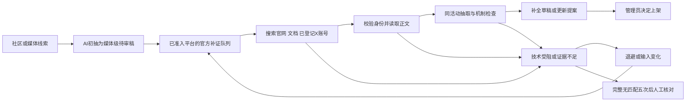

# 社区条目自动官方复核

现役机制校对：2026-10-09。实现入口是`pipeline/official-review.ts`、`src/worker/official-review.ts`及共享身份检查；由每小时快速采集和每6小时全量采集自动调用。命令与调度见[运维](operations.md)，字段与审核边界见[数据合同](data-contract.md)。



## 入队与调度

目标是已准入平台的媒体级pending稿或approved条目的媒体级更新提案，包含积压。未知平台、未准入平台、尚未抽成条目的reviewing线索先在原流程处理；官方补证不替代平台准入或线索研判。

默认每轮8条，由`OFFICIAL_REVIEW_LIMIT`或dispatch参数控制；显式0跳过。48小时内截止优先，其次重要福利、尝试次数及发现时间，按提案内容判断；批量至少5条时为最老积压保留一个位置。每条最多2次搜索、3个候选正文、4分钟，受整轮时间和模型预算限制。

任务占位租期20分钟。占位、入库和结果确认检查任务ID、原稿及提案版本；管理员修改期间的旧结果不能覆盖新版本。输入版本变化可重新排队，无业务/证据变化的重复提案不刷新版本。

## 官方身份与活动身份

- 搜索不依赖本机浏览器、Cookie、mcporter或聊天工具。配置了Actions secret `EXA_API_KEY`（2026-10-15已配置）时用Exa REST `/search`，登记的官方站点与X账号以`includeDomains`限定，Exa费用走Exa账户；无密钥时用Exa匿名MCP端点。Exa限流或出错时改用OpenRouter联网搜索，费用计入模型月度付费上限，每轮最多6次。
- 明确的官方出处优先，随后搜索结果和已登记官方页面。重试优先未读候选，最多保留10个候选记录。搜索服务受限时本轮冷却，仍读取其余条目的已知链接；模型/总时限达到上限时收尾。
- 搜索摘要和模型猜的URL仅发现候选。必须重新读取正文，校验跳转后的身份；Jina回退还需来源元信息吻合、无错误警告。普通采集中的间接正文不因此获官方等级。
- 官方网站与登记信源限定域名，兄弟域名须登记。X须是已登记官方/员工账号的具体帖子；共享托管按仓库/路径限定，用户可发布的issue、PR、discussion、wiki及评论不能因位于官方仓库而获官方等级。
- 同厂商不等于同活动。管线和入库双重检查重置、邀请、资助、充值、会员赠送、每日/每月/每周额度、单次活动的机制；不能用月度套餐或别的功能替代单次发放。这是保守机制检查，不保证识别所有同类活动的语义差别。
- 正文须支持原活动；允许以同活动证据校正金额、资格和日期。无法唯一匹配、缺充分连续权益原文、归属不明或字段校验失败时保留原稿。沿用通用规则、平台要点和管理员纠正。

## 完成、恢复与审核

内部`official_review`保存原线索URL、输入版本、jobId、搜索词、候选/采用URL、修改字段、原因、总尝试次数、完整无匹配次数及下次时间，不进入公开接口，不覆盖人工memo。

| 状态 | 处理 |
|---|---|
| checking | 有效占位等待完成；超过20分钟可恢复 |
| matched | 已应用可采信的官方补全，保持待审/提案，由管理员审核 |
| unresolved | 本轮未有可应用匹配；按完整无匹配次数处理 |
| failed | 搜索、正文、模型等受阻，退避继续；不视为活动不存在 |

技术失败与完整无匹配分别记数。一般退避1、2、4、8小时等，最长24小时；48小时内临期的上限1小时。技术故障不消费完整证据尝试，连续5次完整无匹配后转人工；修改输入或后台“重新排入官方复核”可重试。

业务写入已完成而回执丢失时，过期占位仍会恢复：保留当前官方字段、明确提示回执中断并交人工核对，不冒充再次验证成功。结果回执幂等。官方补全发现与其他条目精确冲突时保留原线索给管理员合并，不自动删稿。

该阶段永不自动通过、永不自行标tested。对已有approved版本，同样须通过完整官方正文的条款变化门槛及拒绝记忆检查；jobId不能绕过这道检查。没有新依据保留原稿/人工提案并记为未有可应用匹配。新条目去重和字段保护详见数据合同。匹配完成或耗尽后的审核提醒使用新的对象版本；正常通知仍按claim/ack与对象重叠去重。

## 查看和验证

后台条目的“官方复核”区展示进展与原因；健康页/`ym health`显示等待、checking、退避、耗尽和超时。状态是流程证据，不等于活动事实全正确。

```bash
gh workflow run collect.yml --ref main -f fast_leads=true -f official_review_limit=2
```

这是生产补跑，会写待审，须在授权范围执行。迁移0012增加内部记录列；首次上线顺序为迁移→Worker→推送管线，后续按实际差异发布。

历史真实执行与错配恢复见[第二轮工作流复查](workflow-resilience-2026-10-08.md)，首次修复背景见[第一轮审查](workflow-audit-2026-10-08.md)；当次运行版本与未闭合项见[整理凭证](closeout-2026-10-09.md)。


## 尚未形成条目的受阻线索

`reviewing`线索由每小时/全量采集中的`runLeadReviews`处理，不要求已有offer。3天内的积压自动入队（更早的线索留在后台，管理员补录与手动重试不受限），每轮条数由`LEAD_REVIEW_LIMIT`决定（代码默认4，Actions变量现为10），每条最多3分钟、最多3个官方正文，整段最多12分钟。先读原始官方URL，再搜索官网/文档及登记X账号；已读候选有记录，下轮推进未读页面。保留重要线索优先和最老积压名额。

结果保存在`leads.resolution`，包括任务ID、原因、原文依据、关联活动、尝试数及下次时间：

- 形成新条目：只生成pending稿，原线索标linked；多个候选全部成功才算完成，失败部分继续处理。
- 已有同活动：关联既有ID，不重写已批准或已拒绝的条目。ID碰撞不能代替活动身份判断。
- 原始官方内容明确不形成独立福利：保存具体理由与连续原文后结束线索；搜索不到或页面失败不能按此结案。
- 技术受阻：按1、2、4小时等退避，最长24小时；重要线索上限1小时，保持自动重试。
- 完整核验仍无法判断：3次后转为可操作的线索审核任务，显示原文和原因，可关联已有活动、结束或重新复核，不停留在无操作的提示卡。

后台待审区分别计数“待审条目”和“线索复核”；已关联/已结束线索可在“线索”页筛选追溯。人工处理带读取时版本，自动结果变化后旧卡片返回409；旧retry/dismiss入口同样校验版本。新稿入库也检查任务占位，管理员结束后旧任务不能晚到创建条目。20分钟过期占位可以恢复，写入完成但回执中断时重新查重并关联。

发布需先应用0014迁移（只新增resolution列），再部署Worker和推送管线。0013现有迁移的Drizzle快照台账已补齐，不重复创建已存在表。诊断可用collect输入`lead_review_ids`限定线索，常规定时不设该值。`official_review_limit=0`只跳过offer补证；跳过受阻线索复核另设`lead_review_limit=0`。
