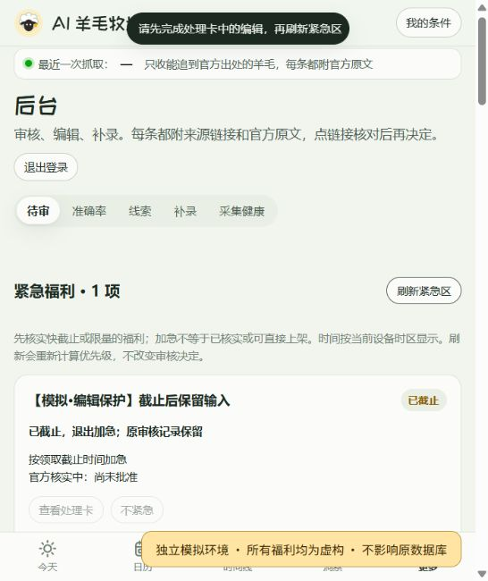
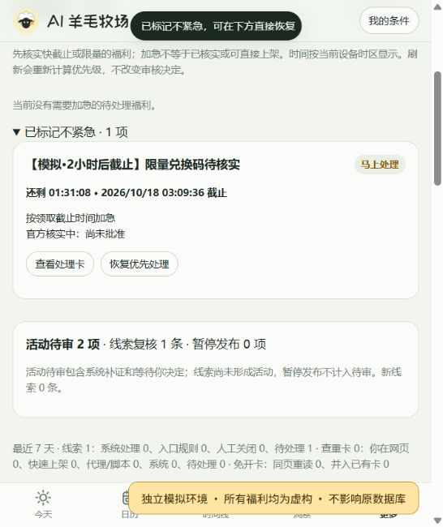

# 紧急福利优先处理第一版

本版在待审页顶部汇总紧急线索、待审活动和查重任务，并调整现有自动核实队列的处理顺序。仅本地实现与验收，尚未推送或部署。

## 行为与边界

- 复用 `classifyUrgency`、`compareQueueOrder` 和时区截止计算；按紧急程度、最迟有用核实时间、发现时间排序。明确截止的项目到期退出紧急区，审核记录保留。
- 查看处理卡定位原卡片；分页外任务、线索按 ID 加载。没有新增绕过证据、版本检查或人工批准的入口。
- 不紧急与恢复即时移动卡片并更新计数；恢复后重新排序，保留编辑内容。偏好绑定内容版本，记录操作者和时间；过期、结案或版本变化拒绝旧请求。
- 到期未打开的卡片隐藏；已有编辑内容的卡片保留，显示已截止、禁用排序按钮，不再计入紧急数。处理卡跨截止返回也不会丢失内容。
- 刷新前后均检查编辑状态；用交互版本和未完成请求计数防止旧刷新结果覆盖新表单或排序操作。
- 自动核实队列复用紧急顺序并保留积压任务名额。领取任务时再次检查截止，保留原有中断任务恢复分支。紧急线索核实超过窗口后交人工，不自动批准或拒绝。
- 仅凭今天发码等措辞加急时要求最近 24 小时内发现；缺少可信截止时刻不编造倒计时。新任务及优先级集合由刷新紧急区更新。

承接[筛选实施计划](superpowers/plans/2026-10-12-lead-screening-redesign.md)的部分能力，不代表整个里程碑 2 完成。不包含新增定时任务、即时提醒、自动发布、历史回填，也不承诺发现后固定时间内完成核实。

## 数据与接口

- 迁移 `0049_review_urgency_preferences.sql` 新建排序偏好表，不伪造旧活动的筛选任务，不改变审核状态或公开字段。
- `GET /api/admin/queue` 增加 `urgent`、`urgencyDismissed`。
- `GET /api/admin/screening/urgent` 获取紧急区；`POST /api/admin/screening/urgency` 提交 key、expectedVersion、suppressed。沿用管理员及审核员权限。
- `GET /api/admin/identity/tasks?id=...`、`GET /api/admin/leads?id=...` 定位原处理对象。
- 发布时须先按运维流程应用迁移；本次只应用过本地迁移，迁移前已备份原本地库。

## 独立模拟预览

运行 `node scripts/preview-urgent-local.mjs`，建立新的 `.wrangler/urgent-preview-<时间戳>/` 数据与静态资源目录，在 `http://127.0.0.1:8788/#admin` 提供预览。原开发库不写入演示数据。脚本无远端模式、生产凭据或定时任务。

样本为四条虚构活动（今天截止、两天后截止、七天后截止、昨天结束）及一条两小时后截止线索。初始三项紧急；普通和过期活动保留原待审区。所有链接使用 `example.invalid`，页面标明独立模拟环境。再次运行生成新库，不覆盖已有样本；需先停止占用 8788 的预览进程。

## 验收结果（2026-10-18）

- 完整工作区回归：124 个文件、1318 项 Vitest 测试通过；审核 CLI 11 项通过。该工作区同时含独立的首屏修复，不能据此宣称这些修复已纳入本提交。
- 类型检查、前端构建、`git diff --check` 通过。
- 后端覆盖：排序、过期及已批准排除、权限、偏好恢复、旧版本拒绝、旧标题降温、已结案任务退出、积压名额、核实超时交人工、截止后拒绝领取任务。
- DOM 覆盖：处理卡展开、恢复顺序、输入保留、刷新与操作请求交错、迟到表单跨截止、计数与隐藏。并发交错使用可控测试，不声称做过浏览器网络故障注入。
- 实际浏览器点击：查看处理卡、不紧急、恢复正常；真实等待短时截止，确认计数下降、未打开卡片隐藏、编辑卡保留文字、已截止标签和刷新保护。
- 浏览器工具最初初始化失败，重开宿主后恢复并完成验收；具体缺失路径未确定，不认定工具根因已修复。
- 本次验收新增临时线索已定向清理，原模拟偏好保留；无真实数据库写入。

验收截图：

## 本地提交范围

包含紧急投影与接口、核实队列、前端紧急区及构建接入、迁移、模拟脚本和相关测试。排除首屏预取、图表降级、附加数据加载、无关时区测试调整和宣传素材。共享文件按片段暂存，未提交内容保留原样。

暂存快照独立验证：从 Git 暂存区导出，排除所有未提交改动。123 个文件、1309 项 Vitest 测试通过；类型检查、前端构建和 11 项审核 CLI 测试通过。完整回归以 TZ=UTC 运行，避免原有相对日期测试依赖本机时区；无关的时区测试修正未纳入提交。日志位于 .wrangler/urgent-staged-tests.log。
